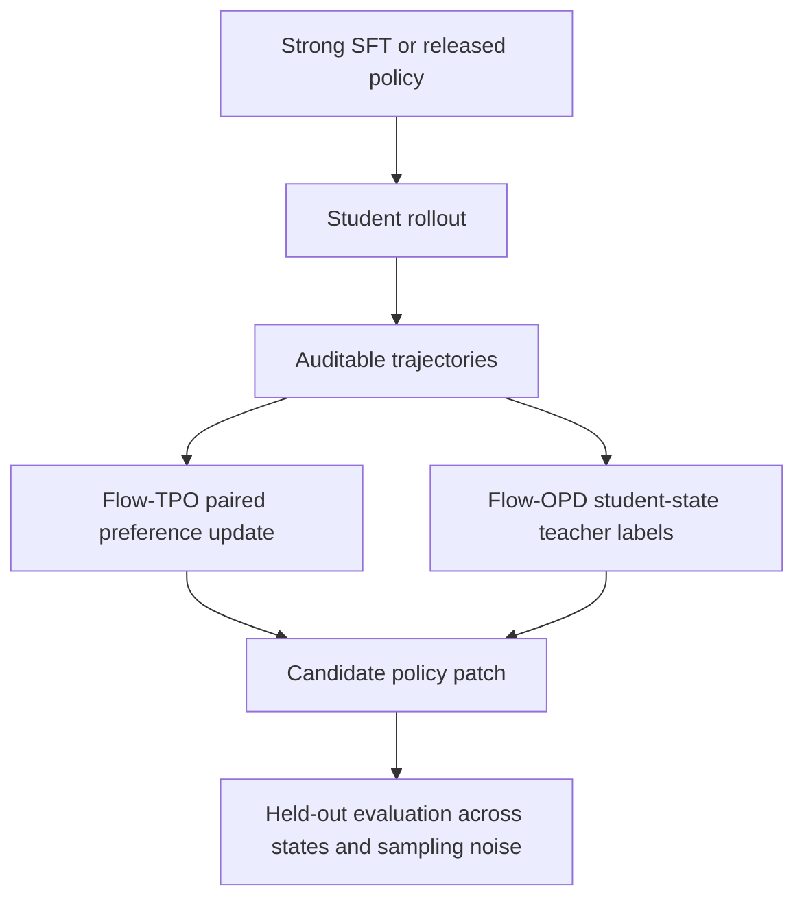

# Flow VLA Post-Training Lab

Research artifacts for two post-training methods for continuous
Flow Matching vision-language-action policies:

- **Flow-TPO**: trajectory-wise preference optimization using paired
  successful and unsuccessful trajectories from the same initial state.
- **Flow-OPD**: on-policy action distillation, where a frozen teacher labels
  states actually visited by the student policy.

This repository is a research/education artifact. It is not a production robot
stack, a standard PPO implementation, a reproduction of official VLA-OPD, or
a claim of real-robot performance.

## Why this exists

Supervised fine-tuning (SFT) teaches a policy how to imitate demonstrations.
The two methods here address different remaining problems:

```text
SFT       : can the policy perform the base task?
Flow-TPO  : among complete trajectories, which behavior should it prefer?
Flow-OPD  : after reaching an off-distribution state, how should it recover?
```



## Methods

### Flow-TPO

For paired trajectories collected under the same task and initial state, the
implementation uses the negative Flow Matching loss as a **surrogate score**:

```text
score(o, a) = -FlowMatchingLoss(o, a)
relative_margin =
  [score_current(chosen) - score_current(rejected)]
  - [score_reference(chosen) - score_reference(rejected)]
```

The frozen reference anchors the update to a capable SFT or released base
policy. This is not a claim that the surrogate is an exact trajectory
log-likelihood.

### Flow-OPD

The student first acts independently. A frozen, protocol-compatible teacher
then predicts an action chunk for selected states the student really visited:

```text
L_OPD = FlowLoss(student_state, teacher_action)
      + replay_weight * FlowLoss(student_state, original_student_action)
```

The teacher is used only to create training labels. Evaluation is performed by
the updated student alone; teacher takeover is not counted as student success.

## Reported Results

The numbers below are small-scale simulation results and should be read with
their limitations. Full tables and protocol notes are in
[`docs/experiment-summary.md`](docs/experiment-summary.md).

| Benchmark / protocol | Base or SFT | TPO / OPD observation |
|---|---|---|
| RoboTwin click_bell, fixed-noise 5 seeds | SFT: 5/5, 70.4 steps | TPO: 5/5, 46.2 steps but higher jerk; OPD reduces TPO jerk modestly |
| LIBERO-10 task 9, one fixed noise, 10 held-out states | Base: 5/10 | Flow-TPO20: 9/10; Flow-OPD20: 9/10 |
| LIBERO-10 task 9, second fixed noise | n/a matched base in this package | Flow-TPO20: 8/10, showing sampling sensitivity |

Do not interpret these as cross-task, real-robot, or statistically conclusive
claims. A third partial noise check exposed instability, and several attempted
variants regressed.

## Repository Layout

```text
algorithms/       Small reference implementations of the update objectives
data/             De-identified aggregate metrics and protocol manifests only
docs/             Detailed methodology, limitations, and experiment summary
```

No model weights, raw camera frames, raw robot trajectories, internal URLs,
credentials, private course material, or private infrastructure information is
included.

## Reproduction Requirements

These reference scripts assume an existing continuous Flow Matching VLA stack
that can provide:

1. `flow_loss(observation, action)` and gradients;
2. a frozen reference policy for TPO;
3. a protocol-compatible frozen teacher for OPD;
4. environment rollouts with task/initial-state identifiers;
5. fixed sampling-noise manifests for fair comparisons.

Before training, verify that teacher and student share robot embodiment,
action dimension/order, coordinate frame, control frequency, camera order,
action horizon, and normalization statistics.

## Limitations and Safety

- `-FlowMatchingLoss` is a surrogate preference score, not an exact action
  likelihood.
- Small preference datasets can overfit rapidly.
- Generative Flow policies require multi-noise evaluation.
- Action-difference jerk is a simulation proxy, not a real-robot safety or
  force metric.
- A real deployment needs action/velocity limits, collision checks, emergency
  stop, watchdogs, shadow mode, human takeover, rollback, and trace logging.

## References

- [pi0: A Vision-Language-Action Flow Model for General Robot Control](https://www.physicalintelligence.company/blog/pi0)
- [pi0.5: A Vision-Language-Action Model with Open-World Generalization](https://www.physicalintelligence.company/blog/pi05)
- [FAST: Efficient Action Tokenization for Vision-Language-Action Models](https://arxiv.org/abs/2501.09747)
- [GRAPE: Generalizing Robot Policy via Preference Alignment](https://arxiv.org/abs/2411.19309)
- [VLA-OPD: Bridging Offline SFT and Online RL via On-Policy Distillation](https://arxiv.org/abs/2603.26666)
- [OpenPI](https://github.com/Physical-Intelligence/openpi)
- [LIBERO](https://libero-project.github.io/)
- [RoboTwin](https://github.com/robotwin-Platform/robotwin)

## License

The original reference code in this repository is released under Apache-2.0.
External model weights, datasets, benchmarks, and upstream implementations
remain subject to their respective licenses.
